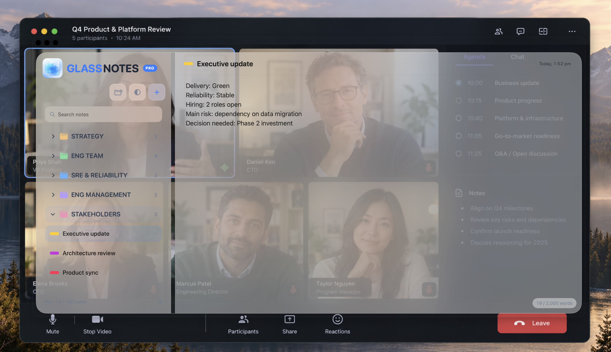
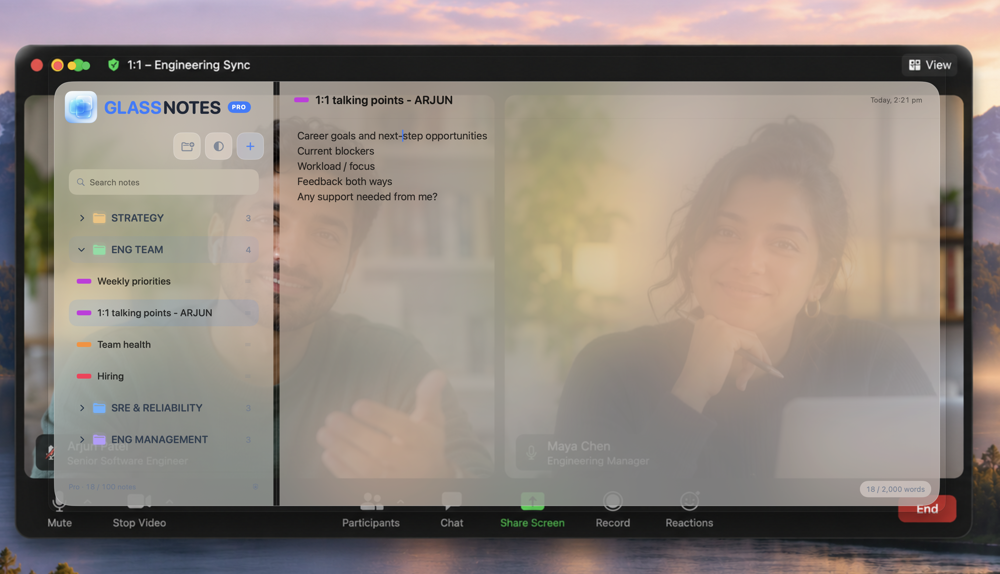
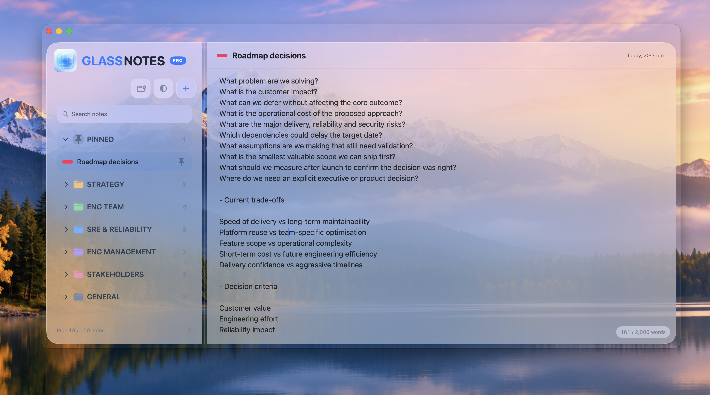

<!doctype html>
<html lang="en-GB">
<head>
  <meta charset="utf-8">
  <meta name="viewport" content="width=device-width, initial-scale=1">
  <meta name="color-scheme" content="light dark">
  <title>GlassNotes — Beautiful notes that stay within reach</title>
  <meta name="description" content="GlassNotes is a lightweight, private notes app for macOS that keeps important thoughts close without cluttering your workspace.">
  <meta property="og:type" content="website">
  <meta property="og:title" content="GlassNotes — Beautiful notes that stay within reach">
  <meta property="og:description" content="A lightweight, private notes app designed for your Mac. Keep important thoughts close without cluttering your workspace.">
  <meta property="og:url" content="https://sithumini.github.io/glassnotes-site/">
  <link rel="canonical" href="https://sithumini.github.io/glassnotes-site/">
  <link rel="stylesheet" href="assets/css/site.css">
</head>
<body>
  <a class="skip-link" href="#main-content">Skip to content</a>
  <header class="site-header">
    

      <a class="wordmark" href="./" aria-label="GlassNotes home">GlassNotes</a>
      <nav aria-label="Main navigation">
        <a href="#features">Features</a>
        <a href="#privacy">Privacy</a>
        <a href="#pricing">Pricing</a>
        <a href="support">Support</a>
      </nav>
    

  </header>

  <main id="main-content">
    <section class="hero shell" aria-labelledby="hero-title">
      

        
GlassNotes for macOS

        <h1 id="hero-title">Beautiful notes that stay within reach.</h1>
        
Keep meeting notes, decisions and reminders in sight while you work — without switching away from what you're doing.

        
Coming soon on the Mac App Store

      

      

        
      

    </section>

    <section class="core-idea section shell" aria-labelledby="core-title">
      

        
Designed to stay close

        <h2 id="core-title">Notes without another workspace.</h2>
        
GlassNotes stays alongside what you're doing. Keep meeting notes, talking points and decisions visible without repeatedly switching between apps.

      

      

        
      

    </section>

    <section class="features section shell" id="features" aria-labelledby="features-title">
      

Features
<h2 id="features-title">Simple by design.</h2>

      

        
      

      

        <article>01
<h3>Organise without clutter</h3>
Group notes around projects, meetings or whatever you're working on.

</article>
        <article>02
<h3>Keep notes within reach</h3>
Keep GlassNotes above other windows when you need it.

</article>
        <article>03
<h3>Make it yours</h3>
Choose colours and adjust the transparency of the sidebar and editor.

</article>
        <article>04
<h3>Find things quickly</h3>
Search across your notes and get back to what matters.

</article>
      

    </section>

    <section id="privacy" class="privacy section shell" aria-labelledby="privacy-title">
      

        

          
Privacy

          <h2 id="privacy-title">Your notes stay yours.</h2>
          
GlassNotes is local-first. Your notes are stored in a folder you choose on your Mac.

          <a class="text-link" href="privacy">Read the Privacy Policy →</a>
        

        <ul class="privacy-points" aria-label="GlassNotes privacy principles">
          <li>No GlassNotes account</li><li>No advertising</li><li>No analytics or tracking</li><li>No GlassNotes cloud storing your notes</li>
        </ul>
      

    </section>

    <section class="pricing section shell" id="pricing" aria-labelledby="pricing-title">
      

Pricing
<h2 id="pricing-title">Start free. Upgrade when you need more.</h2>

      

        <article class="plan">
          

Free

Free

          <ul><li>Up to 2 notes</li><li>Up to 2 groups</li><li>Full GlassNotes experience</li></ul>
        </article>
        <article class="plan plan-pro">
          

GlassNotes Pro

£4.99 / year

Annual subscription

or £9.99 once

Lifetime

          <ul><li>Up to 100 notes</li><li>Up to 8 groups</li><li>Full GlassNotes experience</li></ul>
        </article>
      

    </section>

    <section class="final-cta section shell" aria-labelledby="final-title">
      

        
GlassNotes for macOS

        <h2 id="final-title">Keep what matters within reach.</h2>
        
GlassNotes for macOS.

        
Coming soon on the Mac App Store

      

    </section>
  </main>

  <footer class="site-footer">
    

      
© 2026 Sithumini Senevirathne

      <nav aria-label="Footer navigation"><a href="support">Support</a><a href="privacy">Privacy Policy</a></nav>
    

  </footer>
</body>
</html>
